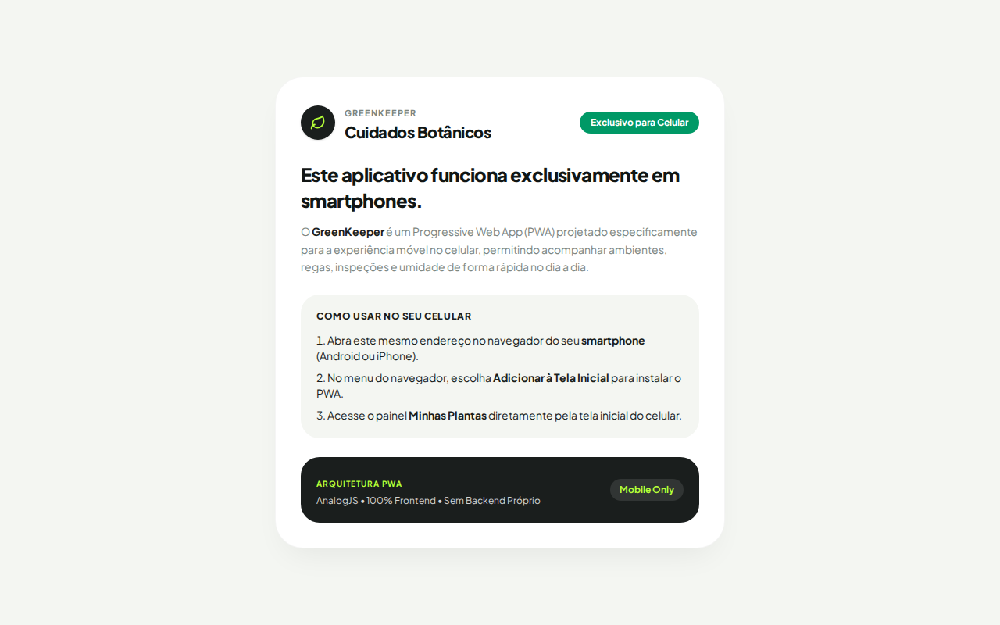

# 🌿 GreenKeeper.AnaloJs

PWA de cuidado de plantas domésticas, **exclusivo para celular**, construído em **AnalogJS (Angular 22 + Vite)** e **100% frontend (sem backend próprio)**. Publicado como site estático no **Netlify**.

> Este repositório contém o esqueleto fundacional com Clean Architecture em TypeScript, 100% de cobertura de testes unitários (Vitest), Mobile-Only Gate, Dashboard Botânico direto (sem tela de login) e captura automatizada de prints via Playwright em Docker.

---

## 📱 Prints das Telas (Gerados via Playwright em Docker)

| Dashboard Mobile (`390x844`) | Tela Informativa Desktop/Tablet (`1280x800`) |
| :---: | :---: |
|  |  |

---

## ✨ Funcionalidades do Esqueleto

- **Mobile-Only Gate (`mobileOnlyGuard` + `EvaluateDeviceAccessUseCase`)**:
  - Libera o aplicativo apenas quando reconhece um smartphone (User-Agent mobile / `userAgentData.mobile` / viewport touch de celular).
  - Bloqueia acessos por desktop e tablet, redirecionando para a **Tela Informativa** (`/desktop-info`).
  - Permite override controlado (`?mobilePreview=1`) **somente fora de produção** (`VITE_APP_ENV !== 'production'`).
- **Dashboard Botânico Direto (`/`)**:
  - Abertura direta no Dashboard (sem tela de login neste esqueleto), fiel ao layout *GreenKeeper — Cuidados Botânicos* adaptado para ocupar 100% da tela real do celular (`100dvh`, sem moldura simulada de iPhone nem barra `09:41`).
  - Ambientes empilhados (*Corredor*, *Sala de Estar*, *Banheiro / Calathea* com métricas de Água e Luz e conclusão de rega pendente).
  - Card *Planta em Foco* (*Aloe Arborescens* com *Rega* e *Inspeção*).
  - Widget *Umidade do Ambiente Ideal* (`64%`) com controle interativo de *Nível Umidificador* (`-` / `+`).
  - Dock flutuante inferior com atalho de câmera.
- **PWA Instalável**:
  - `manifest.webmanifest`, ícones (`192x192`, `512x512`) e Service Worker (`sw.js`) registrados no cliente.

---

## 🏛️ Arquitetura (Clean Architecture Pragmática no Frontend)

```text
src/
├── domain/          # Entidades, tipos e regras puras (zero imports de Angular/infra)
├── application/     # Casos de uso e ports (interfaces TS puras; só depende de domain)
├── infrastructure/  # Adapters concretos (InMemoryDashboardRepository, BrowserDeviceSignalsAdapter, ViteEnvConfigAdapter, BrowserPwaRegistrationAdapter)
├── composition/     # Composition Root (InjectionTokens + provideGreenKeeperDependencies)
├── app/             # Páginas AnalogJS (/ e /desktop-info) e guard mobileOnlyGuard
└── architecture.spec.ts # Testes automatizados de fronteira entre camadas
```

---

## 🐳 Comandos via Docker Compose (Zero Pegada Local)

```bash
# Subir servidor de desenvolvimento (http://localhost:5173)
docker compose up app

# Executar testes unitários com exigência de 100% de cobertura (Vitest + v8)
docker compose run --rm test

# Gerar build estático de produção (dist/analog/public)
docker compose run --rm build

# Gerar prints automatizados das telas mobile e desktop (Playwright)
docker compose run --rm playwright
```

---

## ⚙️ Configurações Local e Produção (Netlify)

1. Copie `.env.example` para `.env` em desenvolvimento local (nunca commitar `.env`).
2. Em produção no **Netlify**, o arquivo [`netlify.toml`](netlify.toml) define o comando de build (`VITE_APP_ENV=production npm run build`), o diretório estático (`dist/analog/public`) e o fallback de SPA (`/* -> /index.html`).
3. Configure as variáveis públicas `VITE_*` na UI do Netlify com escopo **Builds**:
   - `VITE_APP_ENV=production`
   - *(Placeholders preparados para os próximos proposes: `VITE_SUPABASE_URL`, `VITE_SUPABASE_ANON_KEY`, `VITE_AUTH0_DOMAIN`, `VITE_AUTH0_CLIENT_ID`)*.

---

## 🗺️ Roadmap (Próximos Proposes)

1. **Database PostgreSQL + Supabase**: PostgreSQL + PostgREST no Docker local e `@supabase/supabase-js` apontando para o PostgreSQL no Supabase em produção, substituindo o `InMemoryDashboardRepository`.
2. **Autenticação Auth0 + Conta Google**: fluxo de login/logout com Google via Auth0 e envio de JWT para o Supabase.
3. **Convite de Familiar por Email + Notificações**: compartilhamento do mesmo database entre membros da família, envio de convite por email e notificação no PWA instalado no celular da pessoa convidada.

---

## 🤖 Governança e Agentes de IA

Consulte [`AGENTS.md`](AGENTS.md) para as regras completas do repositório, a lista curada de skills de `C:\Users\User\.skills-manager\skills` e a regra obrigatória de executar `graphify update .` antes de todo `git add`.
