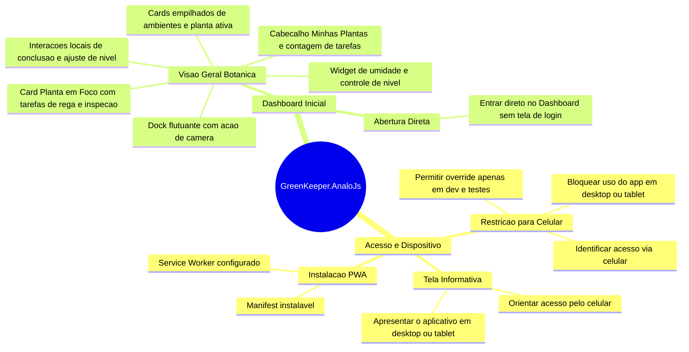
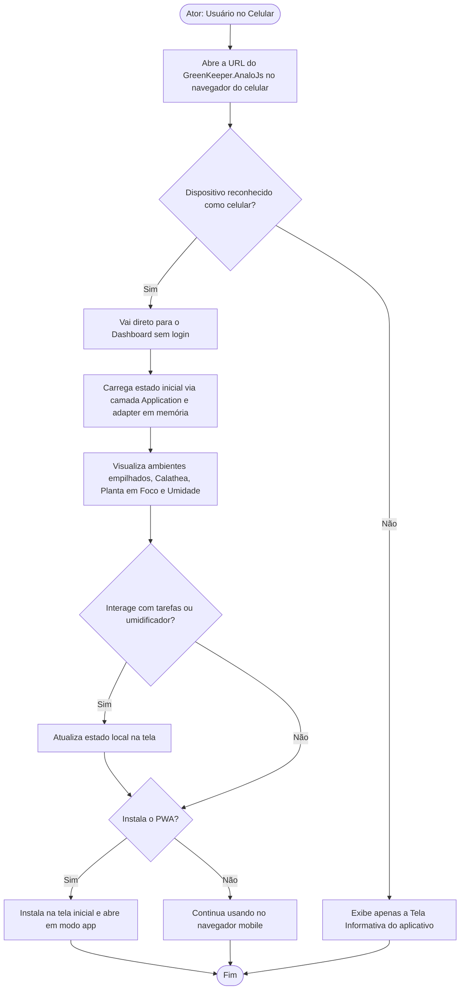
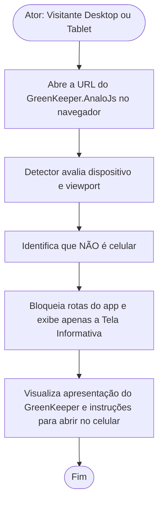
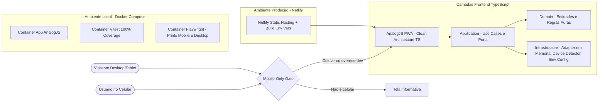

## Visão

**Problema:** Precisamos de uma nova base 100% frontend (PWA, sem backend próprio), simples de desenvolver, testar com rigor e publicar no Netlify para uso exclusivo em celular, substituindo o peso dos toolchains nativos anteriores.
**Solução:** Criar o esqueleto do **GreenKeeper.AnaloJs**, um PWA em **AnalogJS (Angular + Vite)** sem backend próprio, estruturado em TypeScript de forma pragmática próxima à **Clean Architecture no frontend** (`domain`, `application`, `infrastructure`, `app/ui`, `composition`), com **100% de cobertura de testes unitários**, **prints automatizados das telas**, execução via **Docker Compose** (App + Vitest + Playwright), configurações preparadas para **local** e **produção (Netlify)**, **gate exclusivo para celular** (exibindo apenas uma **Tela Informativa** em desktop/tablet) e abertura direta no **Dashboard simples** (visual *GreenKeeper - Cuidados Botânicos* adaptado para tela cheia real do celular, consumindo adapter em memória neste esqueleto), além de `README.md`, `AGENTS.md` com skills relevantes e governança via `rtk` + `graphify`.
**Usuários-alvo:** Pessoas que acessam o app pelo celular para gerenciar suas plantas domésticas diretamente no Dashboard PWA, e visitantes em desktop/tablet que visualizam apenas a tela informativa do aplicativo.

## Mapa Funcional

## Jornadas de Usuário

### Ator 1: Usuário (no Celular)

### Ator 2: Visitante (em Desktop ou Tablet)

## Arquitetura Macro

## Funcionalidades por Área

| Funcionalidade | Ator | Prioridade | Complexidade |
|---|---|---|---|
| Detecção de dispositivo celular + bloqueio em desktop/tablet (com override dev) | Usuário / Visitante | Alta | P |
| Tela Informativa exclusiva para desktop/tablet | Visitante Desktop/Tablet | Alta | P |
| Dashboard mobile direto (sem login) com layout *Cuidados Botânicos* | Usuário no Celular | Alta | M |
| Interações locais no Dashboard (seleção de ambiente, concluir tarefa, +/- umidificador) | Usuário no Celular | Média | P |
| Suporte PWA instalável (manifest + service worker) | Usuário no Celular | Alta | P |
| Estrutura Clean Architecture TS + 100% cobertura unitária + Docker + prints + docs (`README.md`, `AGENTS.md`, `rtk`, `graphify`) | Engenharia | Alta | M |

## Viabilidade

- [x] A solução resolve o problema declarado
- [x] Não duplica funcionalidade dentro do novo repositório `GreenKeeper.AnaloJs`
- [x] Stack tecnológica disponível e validada (AnalogJS + Angular + Vite + Tailwind + Vitest + Playwright em Docker, deploy estático Netlify)
- [x] Escopo bem delimitado (login Auth0/Google, database PostgreSQL Docker + Supabase e convite familiar isolados para próximos proposes)
- [x] Estimativa de esforço adequada para entrega de um esqueleto sólido com 100% de cobertura unitária

## Riscos Iniciais

| Risco | Probabilidade | Impacto | Mitigação |
|---|---|---|---|
| Falso positivo/negativo na detecção de celular (tablets, iPadOS reportando desktop UA, emuladores) | Média | Médio | Combinar `navigator.userAgentData`/`userAgent`, ponteiro (`pointer: coarse`), largura de tela e query/env override controlado apenas fora de produção, com bateria de testes unitários cobrindo todos os cenários |
| Manter 100% de cobertura unitária com arquivos de bootstrap/config do AnalogJS e rotas SSR/client | Média | Médio | Isolar lógica pura em `domain` e `application`, usar Vitest com coverage thresholds de 100% nas camadas cobertas e configurar exclusões explícitas apenas para entrypoints declarativos se necessário, mantendo 100% no código de aplicação |
| Divergência entre viewport headless do Playwright no Docker e aparência real do mockup HTML | Baixa | Baixo | Carregar fonte `Plus Jakarta Sans`, tokens Tailwind e gerar prints em viewports reais (mobile e desktop) dentro do container Playwright para inspeção visual |

## Fora de Escopo

Os itens abaixo ficam **explicitamente fora deste primeiro esqueleto** e registrados para os **próximos proposes**:

1. **Configuração de Database (Propose futuro 1):** PostgreSQL + PostgREST no Docker local, cliente `@supabase/supabase-js` apontando para PostgreSQL no Supabase em produção, criação de schema/tabelas e persistência real substituindo o adapter em memória.
2. **Autenticação Auth0 + Conta Google (Propose futuro 2):** Fluxo de login/logout via Auth0 com provedor Google, proteção de rotas autenticadas e envio de JWT para o Supabase.
3. **Convite de Familiar por Email + Notificações (Propose futuro 3):** Compartilhamento do mesmo database entre membros da família, convite por email e notificação no app instalado no celular da pessoa convidada (Realtime/Web Notification + Edge Functions para Web Push e email).
4. **Módulos completos de negócio do GreenKeeper:** CRUD persistido de Casas, Áreas, Plantas, Histórico de Regas/Adubações/Podas, Open-Meteo e proxies de espécies.
