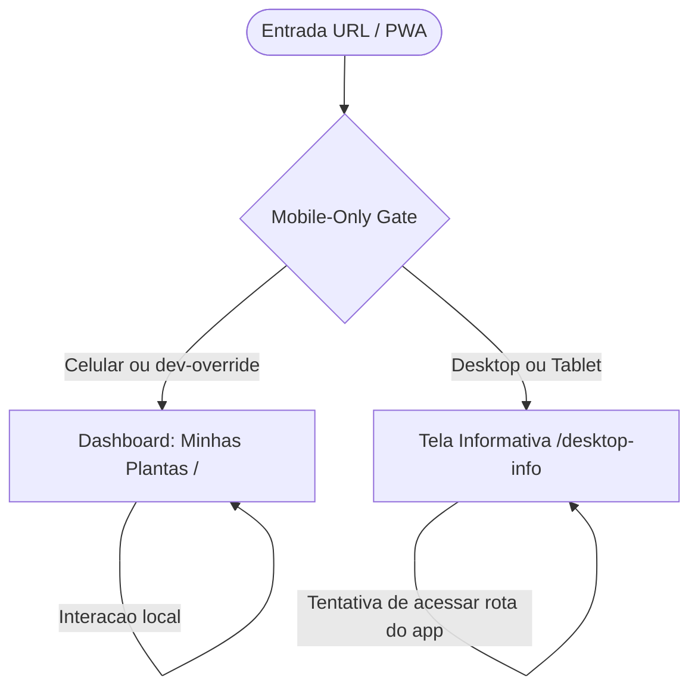

## Fluxo de Navegação



## Telas

### 1. Dashboard Botânico (`Minhas Plantas`)

**Rota:** `/` (quando aprovado pelo Mobile-Only Gate)
**Ator:** Usuário no Celular
**Use Cases atendidos:** UC-01, UC-02, UC-03, UC-04
**Referência visual:** HTML *GreenKeeper - Cuidados Botânicos* adaptado para tela cheia real do celular (`100dvh`, sem moldura externa de desktop e sem status bar simulada `09:41` / Dynamic Island).

#### Tokens Visuais (fiéis ao HTML de referência)
- **Tipografia:** `Plus Jakarta Sans` (`400`, `500`, `600`, `700`, `800`)
- **Fundo app:** `#F4F6F2` | **Charcoal:** `#1A1E1D` | **Emerald ativo:** `emerald-600` (`#059669`) | **Lime highlight:** `#B5FF38` | **Muted:** `#7C8580`
- **Glassmorphism:** `.glass-card` (`rgba(255, 255, 255, 0.72)` + `blur(20px)`), bordas `rounded-[34px]` / `rounded-[32px]` / `rounded-[28px]`

#### Wireframe

```text
+------------------------------------------+
|  (Folha)                       (Sino)    |
|  Minhas Plantas                          |
|  3 tarefas para hoje                     |
+------------------------------------------+
|  +------------------------------------+  |
|  | Corredor                       (o) |  |  <- pill emerald-600
|  +------------------------------------+  |
|  | Sala de Estar                  (o) |  |  <- pill #1A1E1D (sobreposto)
|  +------------------------------------+  |
|  | BANHEIRO                       (o) |  |  <- card branco ativo
|  | Calathea                           |  |
|  |                      [Ilustracao]  |  |
|  | 18%           98%     [Calathea]   |  |
|  | • Agua   |    • Luz      [SVG]     |  |
|  | ---------------------------------- |  |
|  | • REGA PENDENTE        [Concluir]  |  |
|  +------------------------------------+  |
|                                          |
|  +------------------------------------+  |
|  | PLANTA EM FOCO                 (*) |  |  <- glass-card
|  | Aloe Arborescens                   |  |
|  | [ (gota) Rega 1-2x/sem        ⋮ ]  |  |  <- pill emerald-600
|  | [ (olho) Inspecao 2x/mes      ⋮ ]  |  |  <- pill branco
|  +------------------------------------+  |
|                                          |
|  +------------------------------------+  |
|  | 64%                    • • • •     |  |  <- card escuro #1A1E1D
|  | Umidade do Ambiente Ideal   • • •  |  |
|  | ( - )   NIVEL UMIDIFICADOR   ( + ) |  |
|  +------------------------------------+  |
|                                          |
|                 [ (Camera) ]             |  <- dock flutuante inferior
+------------------------------------------+
```

#### Estados da Tela
- **Vazio:** Caso a lista de ambientes venha vazia em testes/stubs futuros, exibe placeholder suave mantendo o header e widget de umidade.
- **Loading:** Skeleton sutil nos cards enquanto `LoadDashboardUseCase` resolve.
- **Erro de carregamento:** Banner discreto dentro da área scrollável sem quebrar a estrutura principal.
- **Sucesso:** Todos os cards carregados com estado reativo atualizado imediatamente ao concluir tarefa, trocar cômodo ativo ou ajustar umidade (`0%`–`100%`).

#### Componentes
- `DashboardHeaderComponent` — ícone folha, botão sino (feedback de esqueleto), título `Minhas Plantas`, subtítulo dinâmico `{N} tarefas para hoje`.
- `StackedRoomsComponent` — pills empilhadas dos ambientes e card principal ativo da planta com SVG da Calathea, métricas `Água`/`Luz` e botão `Concluir`.
- `PlantFocusCardComponent` — card `.glass-card` *Planta em Foco* com *Aloe Arborescens* e itens *Rega* / *Inspeção*.
- `ClimateHumidityWidgetComponent` — card `#1A1E1D` com matriz de partículas, percentual dinâmico e botões `-` / `+`.
- `FloatingCameraDockComponent` — dock flutuante inferior com botão circular da câmera.

#### Ações e Navegação
- **[Tocar ambiente empilhado]** → `SelectRoomUseCase` → destaca o ambiente/planta selecionada.
- **[Botão Concluir]** → `CompletePlantTaskUseCase` → marca tarefa como concluída e decrementa contador do cabeçalho.
- **[Botões `-` / `+` Umidificador]** → `AdjustHumidifierUseCase` → incrementa/decrementa nível entre `0%` e `100%`.
- **[Sino / Câmera / `⋮` / Favorito]** → feedback local discreto indicando módulo planejado para futuras changes.

---

### 2. Tela Informativa (Exclusiva Desktop / Tablet)

**Rota:** `/desktop-info` (e fallback de qualquer rota bloqueada pelo Mobile-Only Gate)
**Ator:** Visitante em Desktop ou Tablet
**Use Cases atendidos:** UC-01, UC-04

#### Wireframe

```text
+----------------------------------------------------------------------+
|  (Folha) GreenKeeper — Cuidados Botânicos                            |
+----------------------------------------------------------------------+
|                                                                      |
|   +--------------------------------------------------------------+   |
|   |  [Badge: Exclusivo para Celular]                             |   |
|   |                                                              |   |
|   |  Cuide das suas plantas diretamente no seu smartphone.       |   |
|   |  O GreenKeeper foi desenhado como PWA mobile-only para       |   |
|   |  acompanhamento rapido de regas, ambientes e umidade.        |   |
|   |                                                              |   |
|   |  Como acessar:                                               |   |
|   |   1. Abra este endereco no navegador do seu celular          |   |
|   |   2. Toque em "Adicionar a Tela Inicial" para instalar       |   |
|   |                                                              |   |
|   |  [URL copiavel / QR informativo estatico]                    |   |
|   +--------------------------------------------------------------+   |
|                                                                      |
+----------------------------------------------------------------------+
```

#### Estados da Tela
- **Vazio / Loading:** N/A (renderização estática imediata sem dependência de dados do usuário).
- **Erro de servidor:** N/A (100% estática, sem chamadas remotas).
- **Sucesso:** Exibe apresentação do aplicativo e instruções claras para acesso via celular, sem expor nenhum dado ou controle do Dashboard.

#### Componentes
- `DesktopInfoPageComponent` — card central alinhado à identidade visual `#F4F6F2` / `#1A1E1D` / `emerald-600` (`Plus Jakarta Sans`), badge informativo e passo a passo de instalação PWA no celular.

#### Ações e Navegação
- **[Copiar endereço]** (opcional client-side) → copia `window.location.origin` para facilitar envio ao celular.
- Nenhuma navegação para `/` ou rotas internas é permitida sem passar pelo Mobile-Only Gate.
