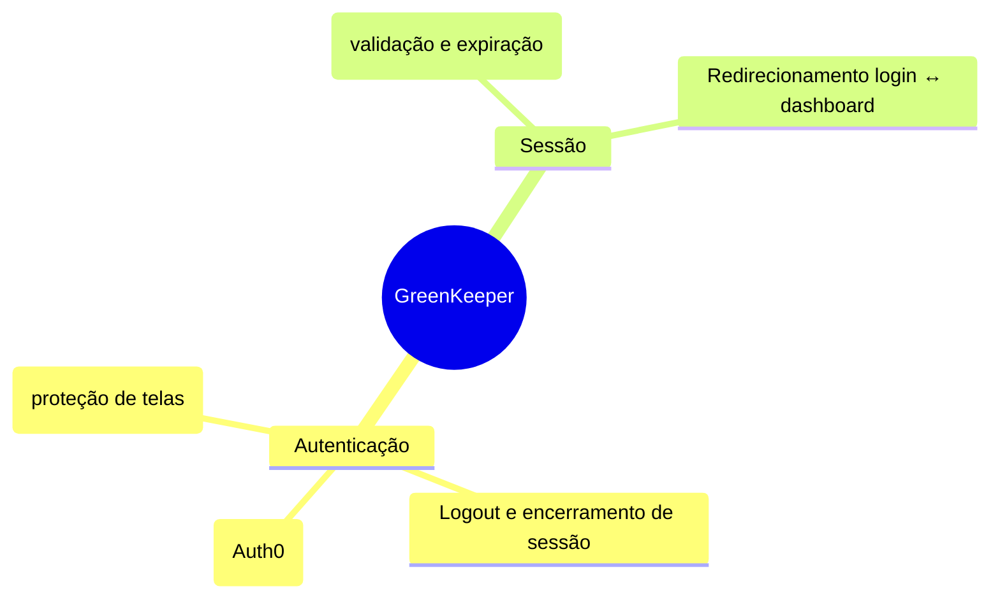

## Visão

**Problema:** O app GreenKeeper permite acesso direto ao dashboard sem autenticação, não havendo isolamento de dados por usuário nem proteção de rotas.

**Solução:** Adicionar autenticação com conta Google via Auth0, com login/logout, sessão ativa e guard de rota que bloqueia acesso não autenticado a todas as telas internas.

**Usuários-alvo:** Pessoas com plantas domésticas que possuem conta Google e querem organizar cuidados de plantas de forma isolada e privada.

## Mapa Funcional



## Jornadas de Usuário

```mermaid
flowchart TD
    A([Usuário]) --> B[Abre o app sem sessão]
    B --> C[Exibe tela de login com "Entrar com Google"]
    C --> D[Toca em "Entrar com Google"]
    D --> E[Redireciona para Auth0]
    E --> F[Login com Google e autorização]
    F --> G[Auth0 retorna com token de sessão]
    G --> H[Sistema valida o token]
    H --> I[Redireciona para o dashboard]
    I --> J([Sessão ativa])

    J --> K[Usuário toca em "Sair"]
    K --> L[Encerra sessão]
    L --> M[Redireciona para tela de login]
    M --> C

    H -->|Token inválido/expirado| C
```

## Arquitetura Macro

```mermaid
graph LR
    U([Usuário]) --> APP[Aplicação AnalogJS/Angular]
    APP --> AUTH[Auth0 (provedor de identidade)]
    APP --> GUARD[Guard de rota]
    GUARD -->|bloqueia| LOGIN[Tela de login]
    GUARD -->|permite| DASH[Dashboard]
```

## Funcionalidades por Área

| Funcionalidade | Ator | Prioridade | Complexidade |
|---|---|---|---|
| Login com Google via Auth0 | Usuário | Alta | M |
| Logout e encerramento de sessão | Usuário | Alta | P |
| Guard de rota (proteção de telas) | Sistema | Alta | M |
| Validação de token JWT (expiração) | Sistema | Alta | M |
| Redirecionamento login ↔ dashboard | Sistema | Média | P |

## Viabilidade

- [x] A solução resolve o problema declarado
- [x] Não duplica funcionalidade já existente no sistema
- [x] Stack tecnológica disponível ou definida (Auth0 placeholders já existem em `netlify.toml` e `.env.example`)
- [x] Escopo é delimitável (sem feature creep — apenas Spec 01)
- [x] Estimativa de esforço é aceitável para o valor entregue

## Riscos Iniciais

| Risco | Probabilidade | Impacto | Mitigação |
|---|---|---|---|
| Token de sessão expirado durante o uso | Média | Médio | Redirecionar para login com mensagem clara |
| Usuário cancela login no Auth0 | Média | Baixo | Retornar à tela de login com mensagem opcional |
| Falha de rede durante o login | Baixa | Médio | Exibir erro e permitir tentar novamente |

## Fora de Escopo

- Login social além do Google (Apple, etc.)
- Cadastro de usuário com email/senha
- Recuperação de senha
- Sincronização de sessão entre dispositivos
- Notificações push relacionadas à autenticação
