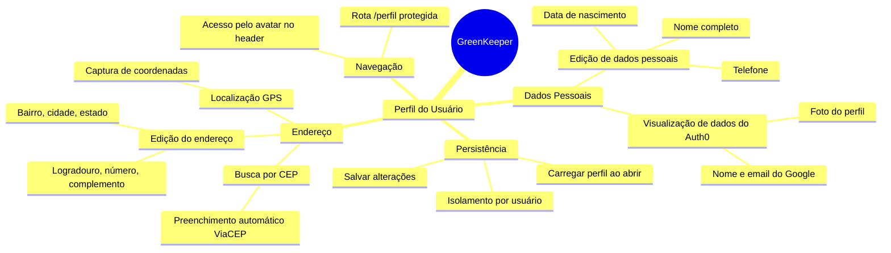
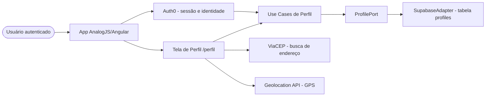

## Visão

**Problema:** O GreenKeeper já autentica o usuário via Google/Auth0 (Spec 01), mas não existe uma área de Perfil. O usuário não consegue consultar ou manter seus dados pessoais (nome, telefone, data de nascimento) nem seu endereço (CEP, logradouro, número, complemento, bairro, cidade, estado e coordenadas GPS), dados necessários para clima local e alertas de cuidado.

**Solução:** Adicionar uma tela de Perfil mobile-only, protegida pelo guard de autenticação, acessível pelo avatar no header, que exibe os dados do usuário autenticado e permite editar e salvar dados pessoais e endereço, com busca de endereço por CEP (ViaCEP) e captura de GPS.

**Usuários-alvo:** Pessoas com plantas domésticas que usam o app em celular e precisam de endereço preciso para clima local e alertas de rega/temperatura.

## Mapa Funcional



## Jornadas de Usuário

```mermaid
flowchart TD
    A([Usuário autenticado]) --> B[Abre o app e toca no avatar no header]
    B --> C[Sistema carrega o perfil salvo]
    C --> D[Exibe dados pessoais e endereço]
    D --> E[Toca em "Editar"]
    E --> F[Habilita os campos editáveis]
    F --> G[Preenche ou edita os dados]
    G --> H[Busca por CEP preenche logradouro, bairro, cidade e estado]
    H --> I[Toca em "Usar minha localização" para preencher o GPS]
    I --> J[Toca em "Salvar"]
    J --> K{Sistema valida os campos}
    K -->|Válido| L[Persiste no Supabase e exibe confirmação]
    L --> M[Volta à visualização com os dados atualizados]
    K -->|Inválido| N[Exibe erro por campo e mantém em edição]
    N --> G
```

## Arquitetura Macro



## Funcionalidades por Área

| Funcionalidade | Ator | Prioridade | Complexidade |
|---|---|---|---|
| Tela de Perfil com dados carregados do Supabase | Usuário | Alta | M |
| Edição de dados pessoais (nome, telefone, data de nascimento) | Usuário | Alta | M |
| Edição de endereço (CEP, logradouro, número, complemento, bairro, cidade, estado) | Usuário | Alta | M |
| Busca de endereço por CEP via ViaCEP | Usuário | Média | P |
| Captura de coordenadas GPS | Usuário | Média | P |
| Avatar no header como ponto de entrada | Usuário | Alta | P |
| Isolamento dos dados por usuário (Auth0 sub) | Sistema | Alta | M |
| Validação de entradas com Zod | Sistema | Alta | P |

## Viabilidade

- [x] A solução resolve o problema declarado
- [x] Não duplica funcionalidade já existente no sistema
- [x] Stack tecnológica disponível ou definida (Supabase/PostgreSQL, ViaCEP, Geolocation API, Zod)
- [x] Escopo é delimitável (sem feature creep — apenas Spec 02)
- [x] Estimativa de esforço é aceitável para o valor entregue

## Riscos Iniciais

| Risco | Probabilidade | Impacto | Mitigação |
|---|---|---|---|
| Tabela `profiles` ainda não existe no Supabase (develop/production) | Alta | Alto | Criar a tabela e a RLS por `auth_id` como parte da change, com script SQL versionado no repositório |
| Usuário nega permissão de localização no navegador | Média | Médio | Exibir mensagem explicativa e permitir digitar o endereço manualmente; GPS é opcional |
| ViaCEP indisponível ou CEP inválido | Média | Médio | Tratar falha de rede com mensagem e permitir preenchimento manual dos campos de endereço |
| Vazamento de dados entre usuários via RLS mal configurada | Baixa | Alto | RLS com `auth.uid() = auth_id` e testes de fronteira validando o isolamento por usuário |
| Perfil não encontrado para usuário recém-autenticado | Alta | Baixo | Criar o registro no primeiro acesso (upsert) a partir dos dados do Auth0 |

## Fora de Escopo

- Exclusão de conta e consentimento de privacidade (LGPD)
- Upload de foto de perfil pelo usuário (usa a foto do Google)
- Múltiplos endereços / endereços de entrega
- Exportação ou compartilhamento de dados do perfil
- Configurações de notificação e preferências de cuidado
- Convite de familiar por email (spec própria)
- Notificações push (spec própria)
