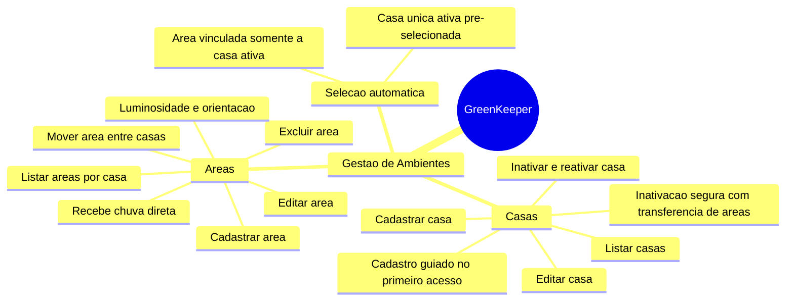
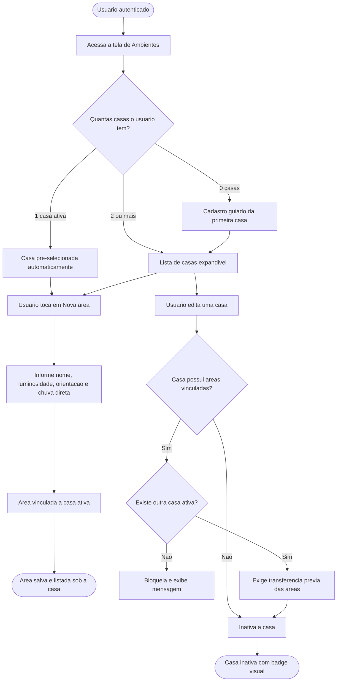
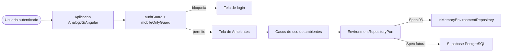

## Visão

**Problema:** O GreenKeeper organiza plantas por ambiente, mas hoje não existe nenhuma estrutura de dados nem tela para cadastrar casas e áreas. O dashboard atual usa cômodos fixos em memória (`Corredor`, `Sala de Estar`, `Banheiro`) do `INITIAL_BOTANICAL_SNAPSHOT`, sem vínculo com o usuário autenticado e sem os atributos que influenciam o cuidado (luminosidade, orientação, chuva direta).

**Solução:** Adicionar a gestão de ambientes — casas (residência/prédio/comercial, com endereço e status Ativa/Inativa) e áreas (cômodos vinculados a uma casa ativa, com luminosidade, orientação e flag "Recebe chuva direta") — com cadastro, edição, listagem, movimentação de área entre casas e inativação segura de casa, tudo persistido por usuário autenticado.

**Usuários-alvo:** Pessoas com plantas domésticas (apartamentos, casas com quintal, varandas) que precisam organizar seus cuidados por ambiente físico. O familiar vinculado (Spec 11, futura) apenas visualiza — não edita nem exclui casas e áreas.

## Mapa Funcional

## Jornadas de Usuário

## Arquitetura Macro

## Funcionalidades por Área

| Funcionalidade | Ator | Prioridade | Complexidade |
|---|---|---|---|
| Listar casas e áreas agrupadas | Usuário (dono) | Alta | P |
| Cadastrar casa (nome, tipo, endereço, status, datas) | Usuário (dono) | Alta | M |
| Editar casa existente | Usuário (dono) | Alta | P |
| Inativar/reativar casa | Usuário (dono) | Alta | M |
| Inativação segura com transferência prévia de áreas | Sistema | Alta | G |
| Cadastro guiado da primeira casa (0 casas) | Sistema | Média | P |
| Cadastrar área vinculada a casa ativa | Usuário (dono) | Alta | M |
| Editar área (nome, luminosidade, orientação, chuva direta) | Usuário (dono) | Alta | M |
| Mover área de uma casa para outra | Usuário (dono) | Média | M |
| Excluir área | Usuário (dono) | Média | P |
| Seleção automática da casa única ativa | Sistema | Média | P |
| Bloqueio de edição/exclusão por familiar vinculado | Sistema | Média | P |

## Viabilidade

- [x] A solução resolve o problema declarado (estrutura de ambientes inexistente)
- [x] Não duplica funcionalidade já existente no sistema (os cômodos em memória são dados de exemplo, não gestão)
- [x] Stack tecnológica disponível ou definida (AnalogJS, Angular 22, Vitest, Playwright, Docker já no repo)
- [x] Escopo é delimitável (Spec 03 trata apenas de casas e áreas; plantas ficam para Spec 04/05)
- [x] Estimativa de esforço é aceitável para o valor entregue
- [ ] Persistência online no Supabase — depende de decisão de quando o adapter online substitui o em memória (ver design.md, Open Questions)

## Riscos Iniciais

| Risco | Probabilidade | Impacto | Mitigação |
|---|---|---|---|
| Inativar a única casa ativa deixando áreas órfãs | Média | Alto | Regra pura no domain bloqueia a inativação e exige transferência prévia; caso de teste dedicado |
| Área vinculada a casa inativa | Média | Médio | Validação no use case rejeita casa inativa; picker de UI só lista casas ativas |
| Familiar vinculado editando/excluindo casas e áreas | Baixa | Alto | Regra de negócio 8 do PRD; capability nega operações de escrita para o papel familiar |
| Endereço da casa duplicar a lógica de CEP/GPS da Spec 02 | Média | Médio | Spec 03 reutiliza o perfil/endereço já resolvido na Spec 02, sem reimplementar busca de CEP |
| Dados de exemplo em memória divergirem das casas reais | Alta | Baixo | Substituir `INITIAL_BOTANICAL_SNAPSHOT.rooms` por dados derivados do repositório de ambientes |

## Fora de Escopo

- Cadastro, listagem e detalhe de plantas (Spec 04 e Spec 05)
- Identificação de planta por foto (Spec 06)
- Edição de casas e áreas por familiar vinculado (não permitida — regra de negócio 8)
- Sincronização de ambientes entre dispositivos
- Modo offline / fila de sincronização
- Upload de fotos de casas ou áreas
- Histórico de alterações de casas e áreas
- Notificações push relacionadas a ambientes