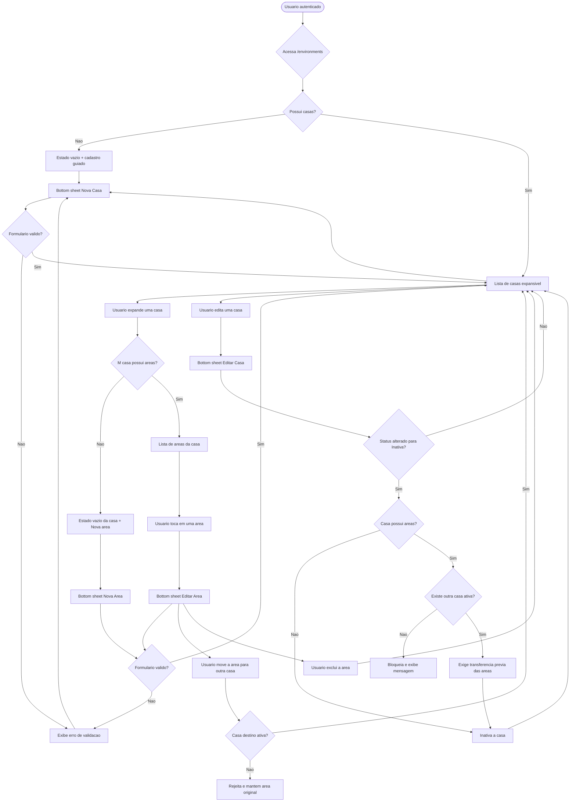

## Fluxo de Navegação

### Telas

| Tela | Rota | Ator | Descrição |
|------|------|------|-----------|
| Ambientes | `/environments` | Usuário (dono) | Lista casas expansíveis com suas áreas e ações de cadastro/edição |
| Nova/Editar Casa | `/environments/houses/new` · `/environments/houses/:id` | Usuário (dono) | Bottom sheet de cadastro e edição de casa |
| Nova/Editar Área | `/environments/areas/new` · `/environments/areas/:id` | Usuário (dono) | Bottom sheet de cadastro e edição de área |

### Transições



### Definição de cada nó

| Nó | Tipo | Ação |
|----|------|------|
| A | Entrada | Usuário autenticado navega para ambientes |
| B | Entrada | Rota `/environments` carregada |
| C | Decisão | Verifica se o usuário possui casas |
| D | Tela | Estado vazio com condução ao cadastro guiado |
| E | Tela | Lista de casas expansível |
| F | Ação | Abre bottom sheet de nova casa |
| G | Ação | Expande uma casa |
| H | Decisão | Verifica se a casa possui áreas |
| I | Tela | Estado vazio da casa com ação "Nova área" |
| J | Tela | Lista de áreas da casa |
| K | Decisão | Valida nome e tipo da casa |
| L | Exceção | Exibe erro de validação no formulário |
| M | Ação | Abre bottom sheet de nova área |
| N | Ação | Toca em uma área existente |
| O | Ação | Abre bottom sheet de edição de área |
| P | Decisão | Valida nome, casa ativa e luminosidade |
| Q | Ação | Move a área para outra casa |
| R | Decisão | Verifica se a casa de destino está ativa |
| S | Exceção | Rejeita a movimentação e mantém a área original |
| T | Ação | Confirma exclusão da área |
| U | Ação | Edita uma casa existente |
| V | Ação | Abre bottom sheet de edição de casa |
| W | Decisão | Verifica se o status foi alterado para Inativa |
| X | Decisão | Verifica se a casa possui áreas vinculadas |
| Y | Ação | Inativa a casa e registra a data de saída |
| Z | Decisão | Verifica se existe outra casa ativa |
| AA | Exceção | Bloqueia a inativação e exibe mensagem |
| AB | Ação | Exige transferência prévia das áreas |

---

## Telas

### Tela: Ambientes

**Rota:** `/environments`  
**Ator:** Usuário (dono)  
**Use Cases atendidos:** UC-01, UC-02, UC-04, UC-09

#### Wireframe

```
+--------------------------------------------------+
|  [Voltar]              Ambientes        [+ Nova] |
+--------------------------------------------------+
|                                                  |
|  v Minha Casa                  [Ativa]           |
|     Residência · São Paulo, SP                   |
|     - Sala                    [Sol Pleno]        |
|     - Varanda                 [Meia Sombra]      |
|     - Quintal                 [Sombra]           |
|                                                  |
|  > Casa da Praia               [Inativa]         |
|     Prédio · Guarujá, SP                         |
|                                                  |
|  v Apartamento                 [Ativa]           |
|     Residência · São Paulo, SP                   |
|     (nenhuma área cadastrada)                    |
|     [+ Adicionar primeira área]                  |
|                                                  |
+--------------------------------------------------+
|  [Nav inferior: Dashboard | Plantas | Cuidados | |
|   Perfil | Configurações]                        |
+--------------------------------------------------+
```

#### Estados da Tela

- **Vazio:** Usuário sem casas → exibe ilustração/estado vazio com call-to-action "Cadastrar primeira casa" (UC-02)
- **Loading:** Durante o carregamento das casas e áreas
- **Erro de validação:** Não se aplica nesta tela (apenas nos bottom sheets)
- **Erro de servidor:** Falha ao carregar ambientes → exibe mensagem com opção de tentar novamente
- **Sucesso:** Casas e áreas listadas, cada casa expansível

#### Componentes
- `EnvironmentsHeaderComponent` — título "Ambientes" e ação "Nova casa"
- `HouseCardComponent` — casa com nome, tipo, endereço resumido, status e badge "Inativa" quando aplicável
- `AreaRowComponent` — área com nome, ícone de luminosidade e flag de chuva direta
- `EmptyHouseStateComponent` — estado vazio da casa com ação "Nova área"
- `EmptyEnvironmentsStateComponent` — estado vazio geral com ação "Cadastrar primeira casa"

#### Ações e Navegação
- **[+ Nova casa]** → abre bottom sheet de nova casa (UC-03)
- **[Expandir casa]** → alterna a exibição das áreas daquela casa (UC-01)
- **[+ Adicionar primeira área]** → abre bottom sheet de nova área com a casa pré-selecionada (UC-05, UC-08)
- **[Tocar em casa]** → abre bottom sheet de edição da casa (UC-03, UC-04)
- **[Tocar em área]** → abre bottom sheet de edição da área (UC-05, UC-06, UC-07)
- **Familiar vinculado** → ações de escrita desabilitadas/ocultas (UC-09)

---

### Tela: Nova/Editar Casa (bottom sheet)

**Rota:** `/environments/houses/new` · `/environments/houses/:id`  
**Ator:** Usuário (dono)  
**Use Cases atendidos:** UC-02, UC-03, UC-04

#### Wireframe

```
+--------------------------------------------------+
|  Nova casa                                    [X] |
+--------------------------------------------------+
|  Nome *                                          |
|  [_______________________________________________] |
|                                                  |
|  Tipo *                                          |
|  ( ) Residência  ( ) Prédio  ( ) Comercial       |
|                                                  |
|  Endereço                                        |
|  [CEP: ___________] [Buscar]                     |
|  [Logradouro, número, bairro, cidade, estado]    |
|                                                  |
|  Status                                          |
|  [Ativa]  ( ) Inativa                            |
|                                                  |
|  Data de entrada: 19/11/2026                     |
|  Data de saída:   (preenchida ao inativar)       |
|                                                  |
|                          [Cancelar]  [Salvar]    |
+--------------------------------------------------+
```

#### Estados da Tela

- **Vazio:** Formulário de nova casa com campos em branco e tipo não selecionado
- **Loading:** Durante o salvamento
- **Erro de validação:** Nome vazio → mensagem "Informe o nome da casa"; tipo não selecionado → "Selecione o tipo"
- **Erro de servidor:** Falha ao salvar → exibe erro e mantém o formulário aberto
- **Sucesso:** Casa salva → retorna à listagem com a casa atualizada

#### Componentes
- `HouseFormComponent` — campos nome, tipo, endereço, status e datas
- `HouseTypeSelectorComponent` — seleção de Residência/Prédio/Comercial
- `HouseStatusToggleComponent` — alternância Ativa/Inativa
- `HouseAddressFieldsComponent` — reutiliza o fluxo de CEP/GPS da Spec 02

#### Ações e Navegação
- **[Salvar]** → valida e persiste a casa (UC-03); se status Inativa, aplica UC-04
- **[Cancelar]** / **[X]** → fecha o bottom sheet sem salvar
- **Inativação bloqueada** → exibe mensagem "Transfira as áreas para outra casa ativa antes de inativar" (UC-04)

---

### Tela: Nova/Editar Área (bottom sheet)

**Rota:** `/environments/areas/new` · `/environments/areas/:id`  
**Ator:** Usuário (dono)  
**Use Cases atendidos:** UC-05, UC-06, UC-07, UC-08

#### Wireframe

```
+--------------------------------------------------+
|  Nova área                                    [X] |
+--------------------------------------------------+
|  Nome *                                          |
|  [_______________________________________________] |
|                                                  |
|  Casa *                                          |
|  [Minha Casa                        (v) dropdown] |
|                                                  |
|  Luminosidade / Exposição solar *                |
|  ( ) Sombra  ( ) Meia Sombra  ( ) Sol Pleno      |
|                                                  |
|  Orientação                                      |
|  [N ( )  S ( )  L ( )  O ( )  NE ( )  NO ( ) ...] |
|                                                  |
|  [x] Recebe chuva direta                         |
|                                                  |
|                          [Cancelar]  [Salvar]    |
|                                          [Excluir]|
+--------------------------------------------------+
```

#### Estados da Tela

- **Vazio:** Formulário de nova área com campos em branco; casa pré-selecionada quando há exatamente uma casa ativa (UC-08)
- **Loading:** Durante o salvamento ou movimentação
- **Erro de validação:** Nome vazio → "Informe o nome da área"; casa inativa selecionada → "Selecione uma casa ativa"; luminosidade inválida → "Selecione a luminosidade"
- **Erro de servidor:** Falha ao salvar/mover/excluir → exibe erro e mantém o formulário
- **Sucesso:** Área salva, movida ou excluída → retorna à listagem

#### Componentes
- `AreaFormComponent` — campos nome, casa, luminosidade, orientação e chuva direta
- `AreaHousePickerComponent` — lista apenas casas ativas; pré-seleciona a casa única ativa
- `AreaLightSelectorComponent` — seleção de Sombra/Meia Sombra/Sol Pleno
- `AreaOrientationSelectorComponent` — seleção de orientação (N, S, L, O, NE, NO, SE, SO)
- `AreaRainFlagComponent` — toggle "Recebe chuva direta"

#### Ações e Navegação
- **[Salvar]** → valida e persiste a área (UC-05); se a casa mudou, aplica UC-06
- **[Excluir]** → confirma e remove a área (UC-07)
- **[Cancelar]** / **[X]** → fecha o bottom sheet sem salvar
- **Nenhuma casa ativa** → exibe mensagem "Cadastre ou reative uma casa antes de criar uma área" (UC-08)

---

### Tela: Confirmação de Inativação de Casa (bottom sheet)

**Rota:** sobreposta a `/environments/houses/:id`  
**Ator:** Usuário (dono)  
**Use Cases atendidos:** UC-04

#### Wireframe

```
+--------------------------------------------------+
|  Inativar casa?                               [X] |
+--------------------------------------------------+
|  A casa "Minha Casa" possui 3 áreas vinculadas.  |
|                                                  |
|  Para inativar, transfira as áreas para outra    |
|  casa ativa.                                     |
|                                                  |
|  [Cancelar]              [Transferir áreas]      |
+--------------------------------------------------+
```

#### Estados da Tela

- **Vazio:** Não se aplica
- **Loading:** Durante a transferência ou inativação
- **Erro de validação:** Nenhuma outra casa ativa → exibe "Você precisa ter outra casa ativa para transferir as áreas"
- **Erro de servidor:** Falha ao transferir/inativar → exibe erro e mantém o diálogo
- **Sucesso:** Áreas transferidas e casa inativada → retorna à listagem com badge "Inativa"

#### Componentes
- `DeactivateHouseDialogComponent` — mensagem contextual e ações
- `AreaTransferListComponent` — lista as áreas a transferir e o seletor de casa de destino

#### Ações e Navegação
- **[Transferir áreas]** → move as áreas para a casa de destino e conclui a inativação (UC-04)
- **[Cancelar]** / **[X]** → fecha o diálogo sem inativar